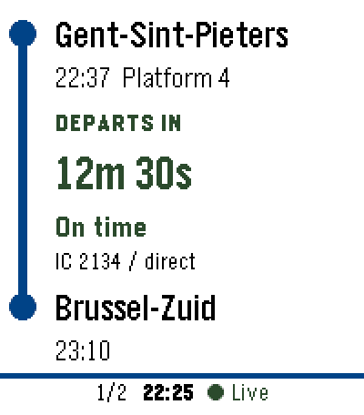
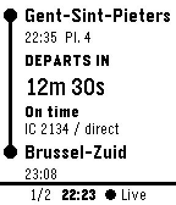
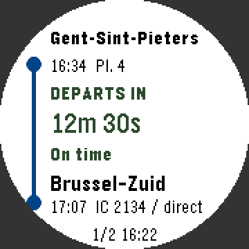
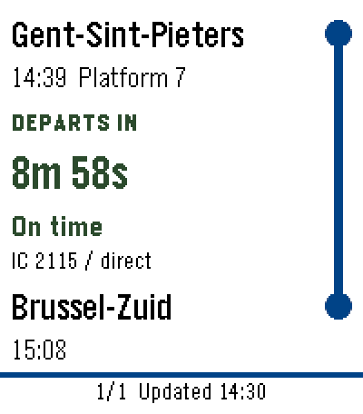
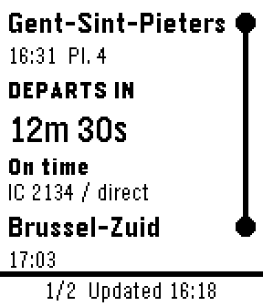
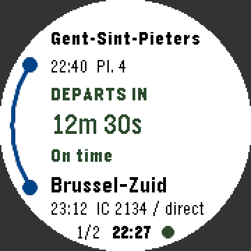
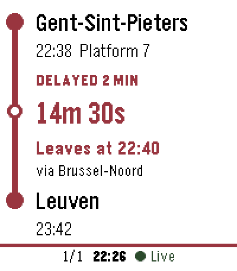
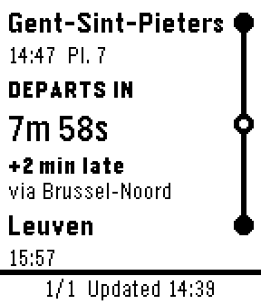
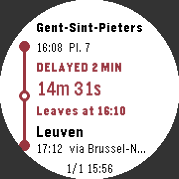

# Traindown for Pebble 2 Duo and Pebble Time 2

A train countdown app inspired by [iRail Traindown](https://github.com/iRail/fitbit-traindown) and NextTrain. One installable bundle supports **Flint (Pebble 2 Duo, 144 × 168 monochrome)**, **Emery (Pebble Time 2, 200 × 228 color)** and **Chalk (Pebble Time Round, 180 × 180 round color)**. The Time 2 uses a larger countdown and color indicators alongside the text labels for delays, cancellations and cached data. On the Time Round every row of text is fitted to the circle: the map runs down the left, the route shares the arrival line, and the journey number and update time sit in the narrow bottom.

**Journey planning runs on your Android phone inside the Pebble app. No hosted backend or separate phone app is required.** The companion includes `@irail/planner` 0.1.3, downloads timetables and real-time updates directly from iRail's CDN, computes journeys locally, and sends compact results to the native C watch interface.

## Features

- One saved station-to-station route, **Gent-Sint-Pieters → Brussel-Zuid** by default. Change it on the watch (see below) or in the Pebble phone app.
- The departure station is shown at the top and the destination at the bottom, joined by a metro-style line on the right with a ring for each station you change at.
- Browse the next six journeys, including canceled journeys.
- Live countdown to departure as `5h 13m 30s`, expected departure and arrival, first platform, delay and the layover stations.
- Refresh on opening and every minute while the watch app is running, and again when the countdown of the selected train ends (so a late delay shows up immediately). A refresh keeps the journey you are following selected instead of jumping back to the first one.
- The departure time shown is the *planned* one (the train you are taking). A delayed train is labelled **DELAYED 4 MIN** (or **DELAYED 1H 05M** from an hour up), the countdown runs to the expected, delayed departure, and the line below gives that time ("Leaves at 15:44").
- The watch buzzes when the selected journey changes: a long vibration when it is canceled, a short one when its delay changes.
- Persistent last-successful results, marked **Cached** after a failed refresh, disconnection, or two minutes without fresh data.
- Atomic Bluetooth updates: an incomplete transfer leaves the previous board intact.

Times on the watch follow the watch's timezone. Set it to Belgium's timezone for Belgian local train times. Delays are included once in expected times; the extra `+N min` label describes that same delay. A platform shown as `?` is unknown. Cached results do not receive further delay or cancellation updates without a connection.

## In action

Recorded in the Pebble Time 2, Pebble 2 Duo and Pebble Time Round emulators (`scripts/record-gifs.sh <platform>`; the corners outside the round screen are filled dark). The phone is simulated: the same messages the phone companion sends are fed to the watch, so the train data is sample data. Times are the clock of the machine that recorded them.

<table>
  <tr>
    <th></th>
    <th>Pebble Time 2 (Emery)</th>
    <th>Pebble 2 Duo (Flint)</th>
    <th>Pebble Time Round (Chalk)</th>
  </tr>
  <tr>
    <td><b>A train that is delayed by 4 minutes, then canceled.</b> The countdown includes the delay, and the line and text turn red.</td>
    <td></td>
    <td></td>
    <td></td>
  </tr>
  <tr>
    <td><b>Changing the destination.</b> Hold Down (on the Time 2 you can also tap the bottom), then zoom in: B, Br, Bru, Brugge.</td>
    <td></td>
    <td></td>
    <td></td>
  </tr>
  <tr>
    <td><b>A trip with a change.</b> Select opens every train, the stops in between and the time to change; here a delay leaves only 2 minutes.</td>
    <td></td>
    <td></td>
    <td></td>
  </tr>
</table>

## Phone requirements

Use the current official Pebble Android app and an up-to-date Android System WebView. Its PebbleKit JS runtime is a Chromium WebView. The browser bundle targets Chromium 100+ and uses modern JavaScript, typed arrays, `fetch`, `AbortController`, `Intl`, and the browser build of Apache Arrow. The planner's main entry runs without Web Workers or Node.js APIs.

The phone keeps an initialized planner while the companion is running, with a **16 MiB connection-page cache** (not a limit on total process memory). It refreshes real-time data on demand at most every 30 seconds and reloads timetable metadata after six hours. Closing the app can discard the phone's in-memory timetable cache; reopening may require fresh downloads. Initial loading uses more data and time than subsequent refreshes. Network operations are canceled after 45 seconds so the watch can offer a retry.

This version targets Android. The iOS Pebble app and older desktop PebbleKit JS simulators have different runtimes and are not supported by this companion build.

## Build and install

Install Node.js **22.12+**, npm, Python 3, and the Pebble SDK with Flint and Emery support, then:

```sh
npm ci
pebble build
pebble install --phone PHONE_IP build/pebble.pbw
```

Enable the phone app's Developer Connection for local installation. Alternatively, sideload the generated `.pbw` through the Pebble mobile app. The bundle includes both Flint and Emery; installation selects the matching binary. Native C supports both watches using one codebase.

The `wscript` bundles the phone code with esbuild, including the compiled Clay settings component and SDK-generated numeric message keys. `enableMultiJS` is intentionally false because the SDK's older webpack cannot parse the planner's modern ESM dependencies. The custom build includes those keys explicitly.

Stations can be changed on the watch itself. The settings page in the mobile app (bundled using `@rebble/clay`) still works too; saved routes continue working and any old service URL is ignored.

## Watch controls

| Button | Action |
| --- | --- |
| Up / Down | Previous / next journey |
| Select | Trip overview of the journey on screen (see below). Refreshes instead when there is no board yet |
| Hold Select | Reverse and save the route, then refresh |
| Hold Up | Change the departure station (the top of the screen) |
| Hold Down | Change the destination station (the bottom of the screen) |
| Tap the top / bottom | Same, on the Pebble Time 2 touchscreen |
| Back | Exit |

### Trip overview

Select opens every train of the journey on the same metro-style rail: where you board with the platform and train, each stop in between with its expected time, and for every change the arrival time and platform, how many minutes you have to change (red below 5, or "Missed connection"), and the next train with its departure time and platform. Delays are included in the times and shown in red on the boarding station. Up/Down scroll and Back returns.

The watch only keeps the headline numbers of the six journeys, so it asks the phone for the one you open (Command 4); the phone keeps the trains and stops of its last three boards for this and answers with Kind 4-7 messages (Kind 8 when the board has expired). Up to 6 trains and 40 stops per train are shown. The board refreshes itself every minute, so there is no manual refresh while a board is showing; Select still retries when there is none, and for a cached board from an earlier session (the phone has no details for it).

### Choosing a station

All 746 stations known to `@irail/planner` are stored on the watch, so the picker works instantly and offline. It narrows the list one level at a time instead of asking you to type: the first screen lists your recent stations and then the letters (`B…  85`), and choosing a group zooms in (`Br…`, `Bru…`) until at most 12 stations remain, which are listed in full. Prefixes that every station of a group shares are skipped. Back zooms out, and closes the picker from the top level. Brussel-Zuid takes Hold Down, then B, Br, Bru and one pick. Choosing the station at the other end of the route swaps the two.

The station list is `resources/stations.txt`, generated from the planner by `node scripts/build-stations.mjs` (needs internet). It must stay sorted the way that script sorts it, because the watch finds all stations with a given prefix as one contiguous range; `npm test` checks this. Two stations whose names the watch fonts cannot draw are left out.

The app needs a connected Pebble phone companion and internet for fresh data. It refreshes only while open. This version does not include background alerts, automatic nearest-station selection, or transfer-by-transfer detail screens.

## Validate

```sh
npm test
pebble build
```

Tests cover delay conversion, cancellation propagation, planner initialization/refresh/retry/timeout behavior, phone message ordering and failure handling, route reversal, and UTF-8 buffer limits.

To exercise the actual bundled companion in Chromium against the live iRail CDN, install a Playwright Chromium browser (`npx playwright-core install chromium`) or set `CHROMIUM_PATH` to an existing Chromium executable, then run:

```sh
npm run test:browser
```

This test simulates the Pebble bridge, opens the bundled settings, saves a route, computes real journeys inside the browser, and checks the resulting watch messages. It reports initial and repeat query timing and download volume in `build/browser-smoke.json`. It does not replace testing the Android app, configuration webview and Bluetooth connection on your phone and watch. Watch layouts and the station picker can be checked in the Flint and Emery emulators; the picker runs entirely on the watch, so `pebble emu-button` works (use `push`, wait, `release` for a long press). The emulator's phone runtime cannot run the planner, so send sample AppMessages to see journeys (the `Via` key carries the layover names; for the trip overview, press Select and then send Kind 4 to 7 messages with the board's Token and Index). Touch input is only available on the Time 2 and has not been tried in the emulator.
