# Traindown for Pebble

A train countdown app inspired by [iRail Traindown](https://github.com/iRail/fitbit-traindown) and NextTrain. One installable bundle supports **Flint (Pebble 2 Duo, 144 × 168 monochrome)**, **Emery (Pebble Time 2, 200 × 228 color)** and **Chalk (Pebble Time Round, 180 × 180 round color)** and **Gabbro (Pebble Round 2, 260 × 260 round color)**. The Time 2 uses a larger countdown and color indicators alongside the text labels for delays, cancellations and cached data. The line from your departure station to the destination, with a ring for each change, runs down the left of every screen; on the round watches it follows the curve of the screen and every row of text is fitted to the circle, with the route sharing the arrival line and the journey number and update time in the narrow bottom.

**Journey planning runs on your phone inside the Pebble app. No hosted backend or separate phone app is required.** The companion includes `@irail/planner` 0.1.3, downloads timetables and real-time updates directly from iRail's CDN, computes journeys locally, and sends compact results to the native C watch interface.

## Features

- One saved station-to-station route, **Gent-Sint-Pieters → Brussel-Zuid** by default. Change it on the watch (see below) or in the Pebble phone app.
- The departure station is shown at the top and the destination at the bottom, joined by a metro-style line on the right with a ring for each station you change at.
- Browse the next six journeys, including canceled journeys.
- Live countdown to departure as `5h 13m 30s`, expected departure and arrival, first platform, delay and the layover stations.
- Refresh on opening and every minute while the watch app is running, and again when the countdown of the selected train ends (so a late delay shows up immediately). A refresh keeps the journey you are following selected instead of jumping back to the first one.
- The departure time shown is the *planned* one (the train you are taking). A delayed train is labelled **DELAYED 4 MIN** (or **DELAYED 1H 05M** from an hour up), the countdown runs to the expected, delayed departure, and the line below gives that time ("Leaves at 15:44").
- The watch buzzes when the selected journey changes: a long vibration when it is canceled, two short pulses when its platform changes and a single short one when its delay changes. A changed platform is also highlighted in a box (orange; black on the Pebble 2 Duo) for as long as the journey is on the board.
- The footer shows the journey number, the time now and how far the data can be trusted, as a symbol and (where there is room) a word: a green dot **Live**, a ring with a dot running around it **Updating**, a grey square **Cached 5m** (age of the data; after a failed refresh or two minutes without fresh data) and a red cross **Offline** (no phone connection). The symbols also differ in shape, for the black and white Pebble 2 Duo. On the Time Round only the symbol fits.
- Persistent last-successful results, marked **Cached** after a failed refresh or two minutes without fresh real-time data, and **Offline** while disconnected.
- Atomic Bluetooth updates: an incomplete transfer leaves the previous board intact.

Times on the watch follow the watch's timezone. Set it to Belgium's timezone for Belgian local train times. Delays are included once in expected times; the extra `+N min` label describes that same delay. A platform shown as `?` is unknown. Cached results do not receive further delay or cancellation updates without a connection.

## In action

Recorded in the Pebble Time 2, Pebble 2 Duo, Pebble Time Round and Pebble Round 2 emulators (`scripts/record-gifs.sh <platform>`; the corners outside the round screen are filled dark). The phone is simulated: the same messages the phone companion sends are fed to the watch, so the train data is sample data. Times are the clock of the machine that recorded them.

<table>
  <tr>
    <th></th>
    <th>Pebble Time 2 (Emery)</th>
    <th>Pebble 2 Duo (Flint)</th>
    <th>Pebble Time Round (Chalk)</th>
    <th>Pebble Round 2 (Gabbro)</th>
  </tr>
  <tr>
    <td><b>A train that is delayed by 4 minutes, moved to another platform, then canceled.</b> The countdown includes the delay, the changed platform is highlighted, and the line and text turn red.</td>
    <td>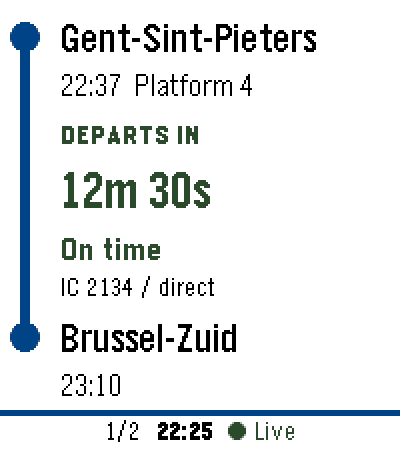</td>
    <td>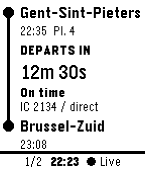</td>
    <td>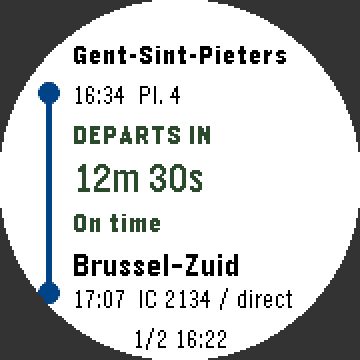</td>
    <td>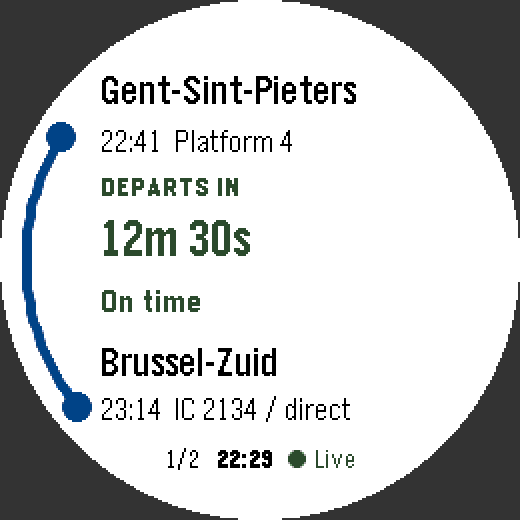</td>
  </tr>
  <tr>
    <td><b>Changing the destination.</b> Hold Down (on the Time 2 you can also tap the bottom), then zoom in: B, Br, Bru, Brugge.</td>
    <td>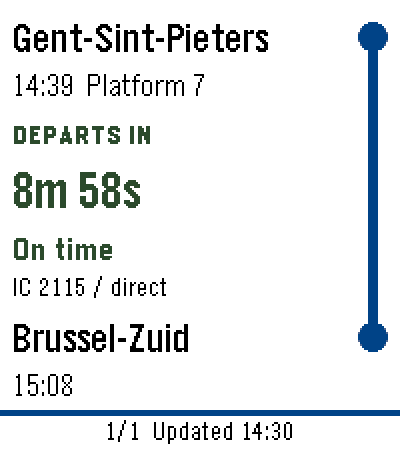</td>
    <td>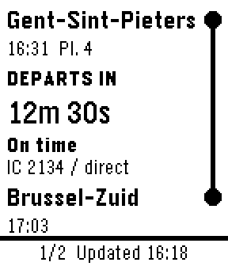</td>
    <td>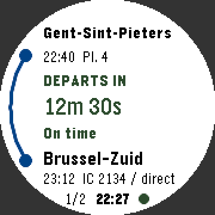</td>
    <td>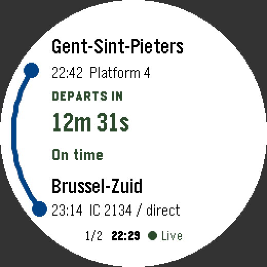</td>
  </tr>
  <tr>
    <td><b>A trip with a change.</b> Select opens every train, the stops in between and the time to change; here a delay leaves only 2 minutes.</td>
    <td>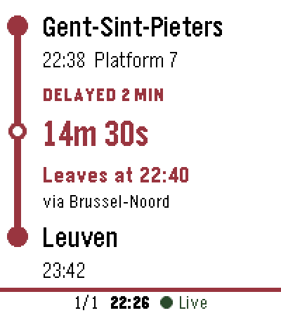</td>
    <td>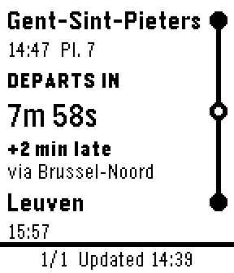</td>
    <td>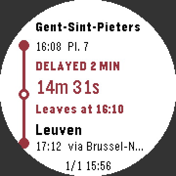</td>
    <td>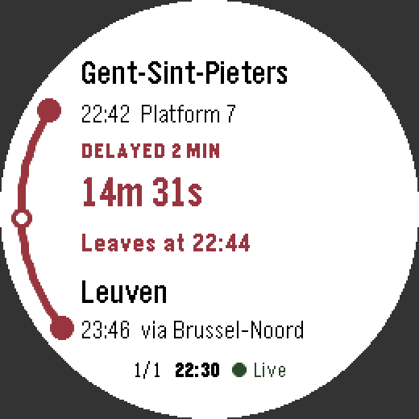</td>
  </tr>
</table>

## Phone requirements

### Android

Use the official Pebble app and an up-to-date Android System WebView. The companion targets Chromium 100+ and keeps the runtime's native web APIs where available.

### iPhone

Use Pebble Core from the App Store. Live departures, settings changes and station selection on the watch have been tested on **iOS 26.5.1 with a Pebble 2 Duo running PebbleOS 4.44.4**, including while Pebble Core was in the background or the phone was locked.

**Leave Pebble Core running in the background.** You can use other apps or lock the phone. In the tested setup, force-quitting Pebble Core (swiping its card away in the app switcher) disconnects the companion and the watch reports **Phone disconnected**. Reopen Pebble Core to restore the connection; Traindown requests fresh data when the connection returns. Traindown depends on Pebble Core to run its phone companion, so this connection behavior must be handled by Pebble Core and iOS.

### Loading and offline use

Both platforms need a connected phone companion and internet access for fresh departures. The watch keeps the last successful board when disconnected, but it receives no new delay or cancellation updates until the connection returns.

The phone plans a journey using its cached timetable pages and last known real-time data first. If a real-time refresh is due, it sends that initial board to the watch with **Updating** in the footer, then downloads the latest delays, cancellations and platforms and replans. You can browse journeys and open their details while this happens. If the refresh fails, the initial board stays available as **Cached**. Its age comes from the real-time feed's timestamp; calculating a new route does not make old data fresh. Without a known feed timestamp, the footer shows **Cached** without an age after the update finishes.

The phone keeps an initialized planner while the companion is running, with a **16 MiB connection-page cache** (not a limit on total process memory). It checks for real-time updates on demand when at least 30 seconds have passed since the last successful check, and reloads timetable metadata after six hours. A route may still need timetable pages that have not been downloaded yet. Terminating the phone companion discards its in-memory cache; restarting it may require fresh downloads. Initial loading uses more data and time than subsequent refreshes. Timetable loading and planning have a 45-second deadline, and the subsequent real-time refresh and replan get a separate 45 seconds. A failed or timed-out real-time refresh keeps the timetable cache for the next request.

Older desktop PebbleKit JS simulators remain unsupported by this companion build.

## Build and install

Install Node.js **22.12+**, npm, Python 3, and the Pebble SDK with Flint, Emery, Chalk and Gabbro support, then:

```sh
npm ci
pebble build
pebble install --phone PHONE_IP build/pebble.pbw
```

Enable the phone app's Developer Connection for local installation. Alternatively, sideload the generated `.pbw` through the Pebble mobile app. The bundle includes all four watch platforms; installation selects the matching binary. The watches share one native C codebase.

The `wscript` bundles the phone code with esbuild, including the compiled Clay settings component and SDK-generated numeric message keys. `enableMultiJS` is intentionally false because the SDK's older webpack cannot parse the planner's modern ESM dependencies. The custom build includes those keys explicitly.

Stations can be changed on the watch itself. The settings page in the mobile app (bundled using `@rebble/clay`) still works too; saved routes continue working and any old service URL is ignored.

## Watch controls

| Button | Action |
| --- | --- |
| Up / Down | Previous / next journey |
| Select | Trip overview of the journey on screen (see below). Refreshes instead when there is no board yet |
| Hold Select | Reverse and save the route, then refresh |
| Hold Up | Change the departure station (the top of the screen) |
| Hold Down | Change the destination station (the bottom of the screen) |
| Tap the top / bottom | Same, on the Pebble Time 2 touchscreen |
| Back | Exit |

### Trip overview

Select opens every train of the journey on the same metro-style rail: where you board with the platform and train, each stop in between with its expected time, and for every change the arrival time and platform, how many minutes you have to change (red below 5, or "Missed connection"), and the next train with its departure time and platform. Delays are included in the times and shown in red on the boarding station. Up/Down scroll and Back returns.

The watch only keeps the headline numbers of the six journeys, so it asks the phone for the one you open (Command 4); the phone keeps the trains and stops of its last three boards for this and answers with Kind 4-7 messages (Kind 8 when the board has expired). Up to 6 trains and 40 stops per train are shown. The board refreshes itself every minute, so there is no manual refresh while a board is showing; Select still retries when there is none, and for a cached board from an earlier session (the phone has no details for it).

### Choosing a station

All 746 stations known to `@irail/planner` are stored on the watch, so the picker works instantly and offline. It narrows the list one level at a time instead of asking you to type: the first screen lists your recent stations and then the letters (`B…  85`), and choosing a group zooms in (`Br…`, `Bru…`) until at most 12 stations remain, which are listed in full. Prefixes that every station of a group shares are skipped. Back zooms out, and closes the picker from the top level. Brussel-Zuid takes Hold Down, then B, Br, Bru and one pick. Choosing the station at the other end of the route swaps the two.

The station list is `resources/stations.txt`, generated from the planner by `node scripts/build-stations.mjs` (needs internet). It must stay sorted the way that script sorts it, because the watch finds all stations with a given prefix as one contiguous range; `npm test` checks this. Two stations whose names the watch fonts cannot draw are left out.

Traindown refreshes only while the watch app is open. This version does not include background alerts or automatic nearest-station selection.

## Validate

```sh
npm test
pebble build
```

Tests cover delay conversion, cancellation propagation, timetable-first planning, real-time freshness and failure recovery, route changes during refreshes, atomic phone message ordering, route reversal, UTF-8 buffer limits, and the iOS fetch fallback's JSON decoding, HTTP status and cancellation behavior.

On Android, PebbleKit JS runs in a Chromium WebView. On iPhone, it runs in JavaScriptCore; the companion supplies missing web APIs and uses Pebble Core's XMLHttpRequest bridge when native `fetch` is unavailable. The bundle targets Chromium 100+ and Safari 15+, uses Apache Arrow's browser build, and runs without Web Workers or Node.js APIs.

To exercise the actual bundled companion in Chromium against the live iRail CDN, install a Playwright Chromium browser (`npx playwright-core install chromium`) or set `CHROMIUM_PATH` to an existing Chromium executable, then run:

```sh
npm run test:browser
```

This test simulates the Pebble bridge, computes real journeys inside the browser, and holds the real-time response until the first board and its trip details arrive. It also checks settings changes, an explicit real-time refresh, and retaining the preview when a refresh fails. It reports initial and repeat preview timing and download volume in `build/browser-smoke.json`. Network errors logged during the deliberately failed refresh are expected.

To check bundle startup and settings generation without browser globals, run the simulated iOS bridge after building:

```sh
node --stack-size=256 scripts/smoke-ios.mjs
node --stack-size=256 scripts/smoke-ios.mjs --live
```

The `--live` check requests a timetable preview followed by a refreshed journey board. The reduced stack size also exercises UTF-8 decoding of large station metadata under conditions similar to the original iPhone stack overflow.

The Chromium and simulated iOS checks exercise the companion's JavaScript and networking. They do not verify Bluetooth or phone background behavior. On physical Android and iPhone devices, check:

- First launch and any network permission prompt, followed by fresh departures on the watch.
- Opening settings and saving a different route, then changing stations on the watch.
- A refresh while the phone app is in the background and while the phone is locked.
- Disconnecting and reconnecting the phone, then receiving a fresh board. On iPhone, also force-quit and reopen Pebble Core to verify recovery.

The first-use iPhone network permission prompt remains unverified. Android compatibility has been checked in Chromium; physical Android testing of the iOS support change remains unverified.

Watch layouts and the station picker can be checked in the Flint and Emery emulators; the picker runs entirely on the watch, so `pebble emu-button` works (use `push`, wait, `release` for a long press). The emulator's phone runtime cannot run the planner, so send sample AppMessages to see journeys (the `Via` key carries the layover names; for the trip overview, press Select and then send Kind 4 to 7 messages with the board's Token and Index). Touch input is only available on the Time 2 and has not been tried in the emulator.
